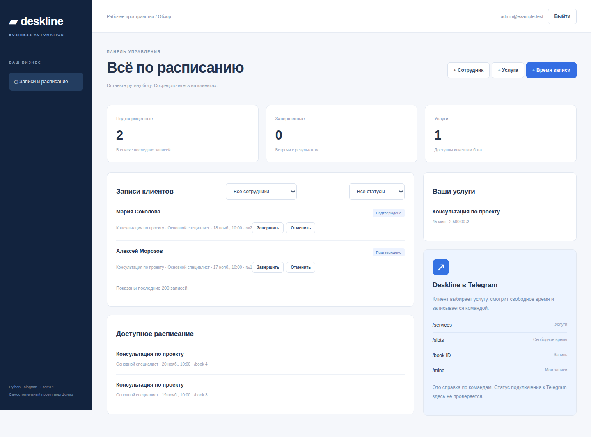

# Deskline — Telegram Business Bot

Самостоятельный Python-проект портфолио: запись клиентов на услуги, расписание и управление заявками. Реализованы aiogram, REST API на FastAPI, административный интерфейс, SQLite и Docker. Платных сервисов нет.

Реализованы aiogram-команды услуг/слотов/записи/отмены, FastAPI REST API и адаптивная административная панель. SQLite-транзакции и уникальный индекс защищают от двойного бронирования, повтор update_id возвращает прежнюю запись. Клиент может отменить только свою запись; администратор управляет услугами, временем и статусами.

## Запуск

Python 3.12–3.14 (проверены CI), отдельное окружение, `pip install -r requirements.lock`. Затем:

```sh
python -m app.setup --admin-email admin@example.test --demo
uvicorn app.api:create_app --factory --host 127.0.0.1 --port 8001
```

Пароль администратора вводится через getpass, встроенного пароля нет. Откройте http://localhost:8001. Демо добавляет вымышленные услуги и будущие UTC-слоты только в пустой каталог. Часовой пояс показывается браузером локально.

Docker: `docker compose up --build -d dashboard`, затем `docker compose exec dashboard python -m app.setup --admin-email EMAIL --demo`. Именованный том deskline-data хранит общую БД панели и бота. По умолчанию Telegram-соединение не запускается.

## Telegram

Команды: /start, /services, /slots, /book ID, /mine, /cancel ID. После задания BOT_TOKEN в локальном окружении запустите `python -m app.bot`; в Docker — `docker compose --profile telegram up -d`. Для общей базы локальные процессы должны использовать одинаковый DATABASE_PATH.

Реальное подключение Telegram потребует BOT_TOKEN в локальном окружении. Токен не следует передавать в чат или коммитить. Без токена будет доступна изолированная проверка входящих обновлений и ответов; она не доказывает успешную доставку в Telegram.

## Проверки и ограничения

`pytest -q`: 10 тестов проверяют транзакционное бронирование, реальный Dispatcher aiogram с перехваченным транспортом и административный HTTP-сценарий. [CI 43863176774](https://github.com/rvrhxg/Telegram-Business-Bot/actions/runs/43863176774) успешно выполнил тесты, Docker build и Chromium вход/создание услуги/завершение записи. [CI 43863564736](https://github.com/rvrhxg/Telegram-Business-Bot/actions/runs/43863564736) также подтвердил запуск контейнера, сохранение услуги и повторный вход после перезапуска, UID1000.

Реальная доставка Telegram не проверена: токен не предоставлялся. В MVP один бизнес и один ресурс расписания; пересечения интервалов запрещены, длительность услуги учитывается. Нет напоминаний, оплаты и нескольких сотрудников. Список записей/слотов ограничен 200; метрики относятся к показанным записям. Это проект портфолио, не production-сервис.

[Архитектура](docs/ARCHITECTURE.md).

## Скриншоты



[Мобильная версия](docs/screenshots/dashboard-mobile.png)


Обновление интервалов: один ресурс бизнеса, занятость [start, start + duration). Проверка внутри BEGIN IMMEDIATE запрещает пересечения между разными слотами и услугами, учитывает смещения часовых поясов. Соседние интервалы допустимы; cancelled освобождает время, completed продолжает занимать исторический интервал. Тесты охватывают частичное пересечение, вложение, обратное пересечение, одинаковое время с разными UTC-offset, смежность и отмену. Интервалы не привязаны к нескольким сотрудникам; реальная Telegram-доставка по-прежнему не проверена.


[Общее портфолио: проекты, запуск, скриншоты и вопросы для собеседования](docs/PORTFOLIO.md). Все проекты — самостоятельные учебные MVP; production-готовность не заявляется.
