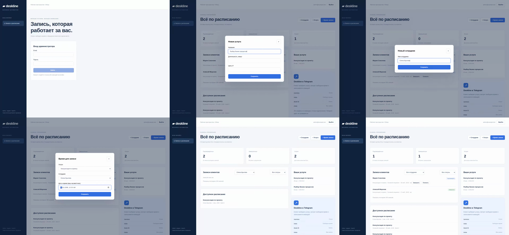

# Видеодемонстрация deskline

Вход в панель, услуга, сотрудник, его слот, фильтр расписания и завершение записи.

[Скачать WebM](https://raw.githubusercontent.com/rvrhxg/Telegram-Business-Bot/main/docs/demo/deskline-demo.webm) · [Метаданные](deskline-metadata.json)

41.17 секунды, 1280×888, без звука. Это реальная запись экрана Chromium с вымышленными данными. Воспроизведение замедлено в3раза для читаемости; исходная длительность 13.72 секунды. В ролике сохраняется desktop viewport; мобильные экраны доступны отдельно в docs/screenshots.

Показана только административная панель. Настоящие Telegram polling и доставка не проверены.

[CI 43939546954](https://github.com/rvrhxg/Telegram-Business-Bot/actions/runs/43939546954), исходный коммит a2ec9ea. Запись воспроизведена Playwright, перекодирована FFmpeg, длительность/разрешение проверены FFprobe; SHA256 совпал с метаданными. Обзорные кадры просмотрены визуально. Это не запись публичного production-сервиса.

## Повторение

Нужны Python-окружение проекта, Playwright1.56.0/Chromium и FFmpeg/ffprobe в PATH. В CI выполняется python -m scripts.demo. Запускайте только в изолированном окружении с вымышленными данными и свободным портом приложения: скрипт создаёт временную БД и локальный сервер. Обычный browser_smoke отдельно проверяет полный сценарий и desktop/mobile скриншоты; запись не заменяет эти проверки.
